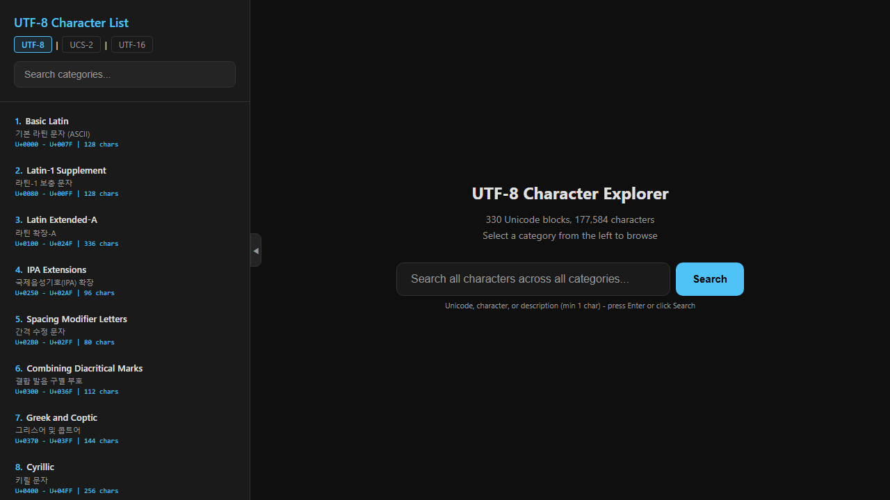
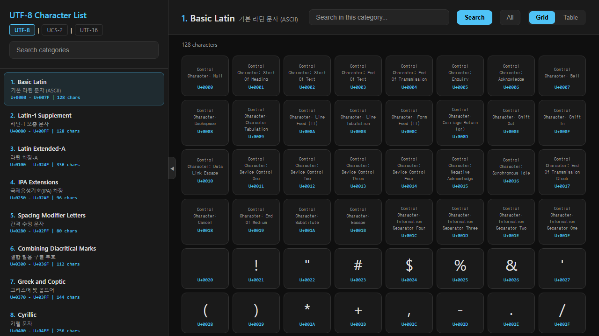

# UTF-8 Character List

An interactive browser for all 177,584 Unicode characters across 330 blocks, with UTF-8, UCS-2, and UTF-16 hex encodings.

**Live Demo:** https://brianmson.github.io/utf8-character-list/

## Screenshots

## Usage

Open any of the HTML files directly in a browser — no server or build step required.

| File | Encoding |
|------|----------|
| `index.html` | UTF-8 |
| `index_ucs2.html` | UCS-2 |
| `index_utf16.html` | UTF-16 |

Each page is fully self-contained (all data is embedded inline).

## Features

- **330 Unicode blocks** — from Basic Latin (ASCII) to CJK Unified Ideographs Extension J
- **Search** — find characters by name, code point, or description across all blocks or within a selected block
- **Grid / Table view** — switch between a visual grid and a detailed table with decimal, Unicode, hex encoding, and character name
- **Encoding navigation** — switch between UTF-8, UCS-2, and UTF-16 views
- **Dark theme** — easy on the eyes

## License

MIT
